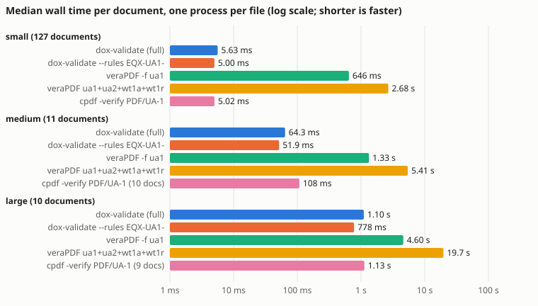

# Performance benchmarks

This document compares the run time and memory use of dox-validate with veraPDF, the open-source PDF/A and PDF/UA validator of the
veraPDF Consortium, and with the PDF/UA-1 verifier of cpdf. All numbers come from the raw measurements in
[`bench/results/`](../bench/results/) and are computed by [`bench/analyze.py`](../bench/analyze.py). The exact
commands to reproduce them are in [`bench/README.md`](../bench/README.md).

**Speed is not validation quality.** The tools check different rule sets (see [Scope](#scope-of-the-comparison)).
A shorter run time does not mean the results are equivalent or correct. Correctness and coverage are analysed
separately, against the expectations of the test corpus.

## Summary

Measured on the frozen corpus: 157 files, 14,000 pages. The comparison covers the 148 documents that dox-validate and
all four veraPDF profiles processed.
dox-validate was measured at commit `f37a695`. The published dox-validate 0.2.0 (commit `5ae7da2`) produced the same
exit codes and findings on every corpus file. Its median wall time per size tier differed from `f37a695` by −0.4% to
0.0%, and its median and maximum peak RSS by at most 0.2 MB
(see [A/B against the published release](#ab-against-the-published-release)).

| measure (CPU set of 8 logical CPUs) | dox-validate (full run) | veraPDF 1.30.4 `-f ua1` (A) | veraPDF ua1+ua2+wt1a+wt1r (B) |
|---|---|---|---|
| one process per document, median per document: small / medium / large | 5.6 ms / 64 ms / 1.10 s | 646 ms / 1.33 s / 4.60 s | 2.68 s / 5.41 s / 19.7 s |
| same, time ÷ dox-validate (median of per-document ratios): small / medium / large | 1 | 117× / 21× / 5.1× | 485× / 84× / 21× |
| one process per document, sequential, whole corpus: documents/s, pages/s | 10.3, 975 | 0.93, 88 | 0.22, 21 |
| one process for the whole corpus, 3 passes: documents/s, pages/s (B: the 4 runs added up) | 11.1, 986 | 2.85, 254 | 0.67, 59 |
| best parallel throughput on the 8-CPU set: documents/s, pages/s | 37.5, 3,340 (8 processes; 8 threads: 37.3) | 4.86, 434 (`--processes 4`) | – |
| peak RSS per process, one process per document: median / maximum | 20 MB / 722 MB | 235 MB / 4,971 MB | 240 MB / 5,075 MB |
| peak RSS, one process for the whole corpus (median of 5 runs) | 820 MB | 8,306 MB | 9,167 MB (largest of the 4 profiles) |

Variability: medians of 5 interleaved repetitions. Min–max ranges, IQRs and the per-repetition spread are given in
the results tables below.

The ratios are largest for small documents. There, veraPDF's JVM start-up (about 0.4–0.6 s per process) dominates
its run time. For large documents the per-page work dominates, and the gap narrows to about 5× for A. Inside one
long-running process, without start-up, the tools' own per-document times add up to 13.6 s for dox-validate and
53.4 s for veraPDF `-f ua1` over the corpus (about 3.9×).

The supplementary measurements:

- `dox-validate --rules EQX-UA1-` took 0.93× the time of the full run per small document, 0.70× per large
  document, and 0.65× in the batch run.
- cpdf took about as long as dox-validate per small document (5.0 ms). On two documents (132 and 350 pages) it did
  not finish within the 120 s timeout.
- veraPDF 1.30.2 performed like 1.30.4 (within 2% in the batch run).

## Scope of the comparison

| tool | what one run evaluates |
|---|---|
| dox-validate | The whole catalogue (2008 rules) in one pass: rules mirroring veraPDF 1.30.2 PDF/UA-1, PDF/UA-2 (with ISO/TS 32005) and WTPDF 1.0 accessibility/reuse; checks mirroring PAC 2026 (PDF/UA, WCAG, quality, including a text-contrast engine that renders page backgrounds); EqualDoX's own WCAG colour checks. It never runs veraPDF or PAC. |
| veraPDF | One validation profile per run (`-f ua1`, `ua2`, `wt1a` or `wt1r`). veraPDF 1.30 has no command-line option for several profiles in one run; `-f` accepts a single value, and the automatic mode (`-f 0`) picks profiles from the file's own conformance claims. |
| cpdf | `-verify "PDF/UA-1(matterhorn)"`: a partial, experimental subset of the Matterhorn Protocol for PDF/UA-1, one file per run. cpdf's manual lists the unimplemented checks. |

Comparisons:

- **A, the most common use:** dox-validate (full run) vs. veraPDF `-f ua1`.
- **B, the same veraPDF profiles dox-validate implements:** dox-validate (full run) vs. veraPDF `ua1` + `ua2` + `wt1a` + `wt1r`. veraPDF needs four separate runs for this; their times are added up per document.
- **Supplementary:**
  - dox-validate `--rules EQX-UA1-`, which evaluates only the 106 rules that mirror veraPDF's PDF/UA-1 profile (parsing and content interpretation still run in full), vs. veraPDF `-f ua1`;
  - veraPDF 1.30.2, the release whose rule semantics dox-validate follows;
  - cpdf (PDF/UA-1 subset).

The full dox-validate run does more work than veraPDF `-f ua1` (more rules, plus contrast rendering) and more than B
(PAC-equivalent and WCAG checks). None of the comparisons disables checks in any tool.

## Tools and configuration

| tool | version | configuration |
|---|---|---|
| dox-validate | 0.2.0. Measured at commit `f37a695` (binary sha256 in `env.json`). The published release dox-validate 0.2.0 is commit `5ae7da2`; see [A/B against the published release](#ab-against-the-published-release). Release build (`-O2`), GCC 16.2.1, qpdf 12.4.2, pugixml 1.16, zlib 1.4 | `--format json --jobs N`; defaults otherwise (`--max-memory-mb 4096` per file, `--max-locations 1000`) |
| veraPDF | 1.30.4 greenfield (current stable release, 2026-11-09); 1.30.2 greenfield (supplementary) | Official installer in unattended mode. Greenfield is veraPDF's own PDF parser and the only parser 1.30 ships (the PDFBox build was last released for 1.28). `--format json`; all other options at their defaults (no `--maxfailures`, `--maxfailuresdisplayed` 100). The default `~/.verapdf/config` holds default values. |
| JVM | Eclipse Temurin 21.0.13+9 LTS (HotSpot), JRE | No JVM options (`JAVA_OPTS` unset). Ergonomics on the 8-CPU set: G1 GC, max heap 30 GiB (1/4 of RAM, capped for compressed oops), initial heap 2 GiB, 8 parallel GC threads, 4 JIT compiler threads. The launcher passes only `-Dfile.encoding=UTF8` and `--add-exports`. |
| cpdf | 2.9.3 AGPL binary (2026-10-20), Linux x86_64 | `-verify "PDF/UA-1(matterhorn)" -json FILE` |

All downloads are pinned by SHA-256 in [`bench/setup_tools.sh`](../bench/setup_tools.sh).

## Tools investigated but not benchmarked

Only tools that can be obtained legally and run unattended on Linux were benchmarked. The following tools were
checked and excluded. No numbers are reported for them.

| tool | vendor | reason for exclusion |
|---|---|---|
| PAC 2024 / PAC 2026 | axes4 / PDF/UA Foundation | Windows-only GUI (.NET); no command-line or batch interface. See [PAC (PDF Accessibility Checker)](#pac-pdf-accessibility-checker) below. |
| axesCheck | axes4 | Web upload form only, no API. Run time would mostly measure the network. |
| axesSense / PAC engine API | axes4 | Commercial REST service, available on request (no public trial). Cloud-based, so not a local performance comparison. |
| callas pdfToolbox CLI/Server | callas software | Linux CLI exists but is commercial; only a time-limited trial licence is available. Its EULA was not checked for benchmark-publication terms, and its PDF/UA profile coverage was not verified. Not run. |
| PDFix SDK / PDFix validation | PDFix | Its PDF/UA validation runs the bundled veraPDF, so it is not an independent engine. The SDK needs a licence key; without one, output is watermarked or altered. |
| Adobe Acrobat Pro accessibility checker | Adobe | Windows/macOS GUI only. Adobe restricts automation to client installations. Its "Full Check" is not a PDF/UA validator. |
| Adobe PDF Services "PDF Accessibility Checker" API | Adobe | Cloud REST API (free tier 500 transactions/month). Documents must be uploaded and timing is dominated by the network, so it is not a local performance comparison. |
| CommonLook PDF Validator | Allyant | Windows plug-in for Acrobat, GUI only. |
| Foxit PDF Editor Full Check | Foxit | Windows/macOS GUI only. |
| iText Core `pdfua` module | Apryse/iText | Java library that checks conformance while a document is being created. No CLI for validating existing files; using it would need custom glue code. |
| Apryse SDK accessibility | Apryse | Auto-tagging and conversion, not a validator. Commercial. |
| pdf_oxide 0.3.78 | open source (MIT/Apache-2.0) | The PDF/UA checks exist only in the library API. The released CLI (`pdf-oxide`) has no `validate` command (checked). Coverage unverified. |
| outloud | open source (Apache-2.0) | Young project (no tagged release; about 10 commits). PDF/UA-1 and WCAG 2.2 with 91 self-reported rules. Not pinnable to a release. A candidate for a future comparison. |
| pdfua (PyPI), pdfa11y | open source | Triage tools with 16 and 9 checks respectively, not comparable validators. |
| pdf-a11y (PyPI), PDF4WCAG | — | Remediation tools or front ends that use veraPDF for validation. |
| Apache PDFBox Preflight, qpdf `--check`, pdfcpu `validate` | open source | Not accessibility validators (PDF/A-1b or syntax checks only). |
| Ace by DAISY, Tingtun/EIII checker | — | EPUB only, or web service only. |

### PAC (PDF Accessibility Checker)

PAC is the most direct counterpart to dox-validate's PAC-equivalent checks. It was investigated in detail (2026-11-14).
No PAC numbers are reported, for the reasons below.

**Version and interface.** The current release is **PAC 2026.1 (26.1.0.0)**, free of charge from
pac.pdf-accessibility.org, for Windows only (it requires .NET Framework 4.8).

- PAC is an interactive GUI that checks one document at a time. It ignores file arguments on the command line.
  Documents are opened only through its "Open document" dialog, and the results are shown in the window or exported
  as a PDF report by further clicks.
- It has no batch mode and no machine-readable output.
- axes4 offers automated checking with the PAC engine as a separate commercial product: a REST API with JSON results
  (axesPAC / axesSense). That would measure a hosted service rather than a local validator.

**Licence.** axes4's General Terms, which replace the end-user licence agreement of PAC 2024, have these relevant
clauses:

- They prohibit reverse engineering, decompiling and modification, as well as offering PAC as a commercial hosting
  service.
- They contain no clause on GUI automation, benchmarking, publishing results, or running PAC on other operating
  systems.

Nothing was reverse-engineered or modified for this investigation.

**Environment.** No Windows machine was available for this benchmark. PAC 2026.1 does start on the benchmark host
(Arch Linux) under Wine 11.20 Staging, with the official installer and .NET Framework 4.8 in a dedicated prefix.
axes4 provides PAC for Windows only.

**Feasibility check under Wine.** PAC was driven through its own GUI, with Windows UI Automation and simulated input,
on a hidden display. The check showed that a benchmark run this way would not be reliable or comparable:

- **Input.** Submitting files through the "Open document" dialog was unreliable under Wine. Typed paths changed their
  letter case, the file-name field kept the previous entry, and the resulting error dialogs stopped unattended runs.
- **Completion.** PAC gives no signal when a check is finished. The end can only be inferred from the GUI or from
  the process's CPU activity. Either way, PAC's own rendering of thumbnails and result views is included.
- **Run time.** Every timing would include Wine's translation layer. It would describe PAC under Wine on Linux, not
  PAC as distributed and used on Windows.
- **Memory.** Under Wine the PAC process already held about 1.5 GB resident before checking the first document. Its
  peak memory therefore cannot be compared with that of a command-line validator.
- **Parallelism.** The GUI processes one document at a time, so parallel throughput cannot be measured.
- **PDF 2.0.** PAC 2026 does not support PDF 2.0; it checks such files as PDF/UA-1. The corpus's PDF 2.0 files would
  need to be left out.

**Scope.** Each PAC check covers the following:

- its PDF/UA tab: PDF/UA-1 via the Matterhorn Protocol;
- its WCAG tab;
- its Quality tab;
- in PAC 2026, AI-assisted checks.

A full dox-validate run includes checks that mirror PAC's PDF/UA, WCAG and Quality checks. It also checks PDF/UA-2
and WTPDF. Neither tool runs the other.

**What a valid comparison would need:**

- a Windows 10/11 x64 machine of a comparable hardware class, or a VM with a fixed CPU allocation;
- PAC 2026.1, the same corpus without the PDF 2.0 files, and one warm PAC instance checking the documents
  sequentially;
- explicit completion detection on the result view through UI Automation, and five interleaved repetitions;
- peak memory taken from the PAC process's peak working set, relative to its idle working set, and reported
  separately from dox-validate's per-process peak resident memory.

## Environment

The full record is in [`bench/results/env.json`](../bench/results/env.json).

| | |
|---|---|
| CPU | Intel Core i9-14900KF (8 P-cores with SMT and 16 E-cores, 32 logical CPUs). The tools ran on CPU set 0-7, which is 4 P-cores with both SMT siblings (pairs 0/1, 2/3, 4/5, 6/7), max 5.7 GHz. |
| Frequency control | intel_pstate, governor `powersave`, EPP `balance_performance`, turbo enabled. |
| Memory | 188 GiB |
| OS | Arch Linux, kernel 7.3.4 |
| Scheduling | Every tool process inherits the affinity of the spawning thread (CPU set 0-7). Niceness is 5 for both tools, inherited from the session. The RSS sampler thread is pinned to CPU 16, outside the set. Reports go to tmpfs (`/dev/shm`). The corpus files are read once before each block, so all tools read from the page cache. |
| Background load | The host was in normal use while the benchmark ran: a desktop session, browsers and other batch jobs, some of them CPU-heavy. They were not restricted to other CPUs. See [Background load](#background-load). |

## Corpus

The benchmark uses the frozen test corpus from `tests/corpus/`, built by `python3 tests/corpus/build_corpus.py`
(`corpus_manifest.json` sha256 `3b03181043e3205bac6155d229fc0be98c7955a9113deadb30e9fb946b1ffae4`). The harness checks
that hash against `tests/corpus/CORPUS_READY` and checks every file against its sha256 in the manifest before
measuring. All tools get the same files.

The corpus has 157 files, 14,001 pages and 131 MB:

- 84 generated fixtures (small documents, including malformed, encrypted and empty files);
- 6 generated size-tier documents (20, 100, 500 and 2000 pages, simple and complex);
- 67 public documents (veraPDF PDF/UA-1 and PDF/UA-2 corpus files, and real-world government, standards, manual and
  arXiv documents of up to 4215 pages).

The manifest assigns each file a size tier (small/medium/large) and a complexity class (simple/complex). The
per-document comparison uses the documents that dox-validate and all four veraPDF profiles processed. Nine
malformed, encrypted or empty fixtures are excluded and listed below the cold-start table. veraPDF rejected all nine.
dox-validate rejected eight; the ninth (malformed-bad-xref) it processed with an incomplete result.
Whole-corpus runs (batch, parallel) include them, because rejecting a broken file is part of a run over a real
collection.

## Method

Measurement:

- [`bench/rusage_exec.c`](../bench/rusage_exec.c) runs every tool process and measures:
  - wall time (`CLOCK_MONOTONIC` around fork … `wait4`);
  - user and system CPU time;
  - peak RSS (`ru_maxrss` of the process tree, i.e. of its largest process; the veraPDF launcher `exec`s the JVM, so
    this is the JVM's peak RSS).
- The helper is used because Linux carries the RSS high-water mark of the parent image across `fork`/`exec`. Without
  it, every tool started directly from the Python harness would report at least the harness's ~30 MB.
- For runs with several processes (veraPDF `--processes N`, worker pools), the harness also samples the summed RSS of
  all live processes of the run every 20 ms.
- After each run the harness parses the JSON report and records, per file, whether it was processed. Runs with a
  timeout, a signal or an unreadable report are counted as failures and excluded from timing.
- Timeouts:
  - 120 s for a one-document process (about 10× the slowest veraPDF document);
  - 1800 s per pass for a whole-corpus process.

Blocks:

| block | what it measures | repetitions |
|---|---|---|
| startup | `--version`, and validation of the smallest corpus file (`pdf20-simple`, 1 page), one process each | 10, interleaved |
| cold | one process per document and tool, for every document; the usual way a validator is called from scripts and CI | 5; documents shuffled per repetition; tool order rotated per document |
| batch | one process per tool over the whole corpus, 3 passes in the same process (sustained, sequential, with JIT warm-up); per-document times reported by the tools themselves | 5, tool order rotated |
| parallel | one pass over the corpus with N = 1, 2, 4, 8 workers on the 8-CPU set: the tool's own parallelism (dox-validate `--jobs N` threads; veraPDF `--processes N` child JVMs) and a pool of N concurrent one-document processes | 5, configurations rotated |

Statistics:

- Every reported value is a median over repetitions, with min–max or IQR given.
- For the cold block, each document gets its median over the 5 repetitions.
- Tier and class figures are then the median over documents, and throughput is computed from the sum of the
  per-document medians.
- The ratio to dox-validate is computed per document; the table shows the median of these ratios and, in brackets,
  their geometric mean.

## Results

All tables are generated by `bench/analyze.py` into [`bench/results/tables.md`](../bench/results/tables.md), which also
has a per-tool table for every size tier and complexity class with IQR, maximum and throughput. Raw data:
`startup.csv`, `cold.csv`, `batch.csv`, `batch_files.csv`, `parallel.csv`, `ab_published.csv`, `load.jsonl`.

### Corpus composition

| tier | complexity | files | pages | bytes | pages per file |
|---|---|---|---|---|---|
| small | complex | 122 | 152 | 6.37 MB | 1–10 |
| small | simple | 13 | 15 | 4.42 MB | 0–9 |
| medium | complex | 6 | 636 | 8.69 MB | 26–260 |
| medium | simple | 5 | 352 | 12.29 MB | 20–132 |
| large | complex | 5 | 4075 | 42.89 MB | 350–2000 |
| large | simple | 5 | 8771 | 56.69 MB | 500–4215 |

### Start-up

One process each; median of 10 repetitions, min–max.

| tool | call | runs | wall | min–max | CPU (user+sys) | peak RSS |
|---|---|---|---|---|---|---|
| cpdf 2.9.3 -verify PDF/UA-1(matterhorn) | smallest corpus file | 10 | 4.48 ms | 4.25 ms–4.91 ms | 4.37 ms | 13.0 MB |
| dox-validate (full catalogue) | smallest corpus file | 10 | 4.52 ms | 4.03 ms–5.35 ms | 4.45 ms | 19.2 MB |
| dox-validate (full catalogue) | --version | 10 | 2.94 ms | 2.61 ms–3.18 ms | 2.89 ms | 13.2 MB |
| veraPDF 1.30.4 -f ua1 | smallest corpus file | 10 | 567 ms | 544 ms–715 ms | 1.94 s | 227 MB |
| veraPDF 1.30.4 -f ua1 | --version | 10 | 405 ms | 350 ms–461 ms | 1.37 s | 173 MB |
| veraPDF 1.30.2 -f ua1 | smallest corpus file | 10 | 583 ms | 537 ms–620 ms | 1.97 s | 226 MB |
| veraPDF 1.30.2 -f ua1 | --version | 10 | 370 ms | 341 ms–422 ms | 1.26 s | 174 MB |

### Cold start: one process per document

Median over the documents of the group of the per-document median of 5 repetitions. time ÷ dox-validate: median of the per-document ratios (geometric mean in brackets); a value of 10× means the tool took ten times as long as the full dox-validate run.

| group | docs | pages | dox-validate (full) | veraPDF ua1 | A: ua1 ÷ dox | veraPDF 4 profiles | B: 4 profiles ÷ dox | dox --rules EQX-UA1- | cpdf (documents it completed) |
|---|---|---|---|---|---|---|---|---|---|
| all | 148 | 14000 | 5.71 ms | 652 ms | 115× (79.1×) | 2.73 s | 482× (329×) | 5.07 ms | 5.06 ms (146 of 148 docs) |
| small | 127 | 166 | 5.63 ms | 646 ms | 117× (111×) | 2.68 s | 485× (461×) | 5.00 ms | 5.02 ms |
| medium | 11 | 988 | 64.3 ms | 1.33 s | 20.7× (18.8×) | 5.41 s | 84.2× (78.3×) | 51.9 ms | 108 ms (10 of 11 docs) |
| large | 10 | 12846 | 1.10 s | 4.60 s | 5.11× (5.22×) | 19.7 s | 20.8× (21.9×) | 778 ms | 1.13 s (9 of 10 docs) |
| all/complex | 133 | 4863 | 5.66 ms | 650 ms | 116× (91.2×) | 2.72 s | 483× (381×) | 5.04 ms | 5.03 ms (132 of 133 docs) |
| all/simple | 15 | 9137 | 64.3 ms | 1.23 s | 20.7× (22.5×) | 4.91 s | 84.2× (90.1×) | 49.4 ms | 101 ms (14 of 15 docs) |
| small/complex | 122 | 152 | 5.64 ms | 647 ms | 117× (112×) | 2.68 s | 485× (464×) | 5.00 ms | 5.02 ms |
| small/simple | 5 | 14 | 4.55 ms | 590 ms | 122× (99.4×) | 2.32 s | 496× (397×) | 4.26 ms | 4.54 ms |
| medium/complex | 6 | 636 | 84.8 ms | 1.52 s | 18.7× (16.5×) | 6.26 s | 77.6× (70.3×) | 63.4 ms | 221 ms |
| medium/simple | 5 | 352 | 64.3 ms | 1.29 s | 20.7× (22.1×) | 5.34 s | 84.2× (89.1×) | 49.4 ms | 108 ms (4 of 5 docs) |
| large/complex | 5 | 4075 | 965 ms | 5.52 s | 4.95× (5.28×) | 24.4 s | 20.7× (23.1×) | 694 ms | 2.15 s (4 of 5 docs) |
| large/simple | 5 | 8771 | 1.25 s | 3.68 s | 5.27× (5.15×) | 14.9 s | 20.9× (20.7×) | 1.04 s | 1.08 s |

#### Peak resident memory per process (median / maximum over the documents)

| group | dox-validate (full) | veraPDF ua1 | veraPDF 4 profiles (max of the 4 runs) | cpdf |
|---|---|---|---|---|
| all | 20.4 MB / 722 MB | 235 MB / 4,971 MB | 240 MB / 5,075 MB | 13.2 MB / 1,161 MB |
| small | 20.0 MB / 29.0 MB | 234 MB / 281 MB | 239 MB / 374 MB | 13.2 MB / 22.3 MB |
| medium | 33.4 MB / 242 MB | 549 MB / 3,999 MB | 588 MB / 3,999 MB | 39.7 MB / 354 MB |
| large | 247 MB / 722 MB | 2,518 MB / 4,971 MB | 2,793 MB / 5,075 MB | 208 MB / 1,161 MB |

#### Sequential throughput (documents/s / pages/s / total CPU time)

From the sum of the per-document medians, one process at a time. veraPDF uses several threads per process (JIT compiler, garbage collector), so its CPU time exceeds its wall time.

| group | dox-validate (full) | veraPDF ua1 | veraPDF 4 profiles | cpdf |
|---|---|---|---|---|
| all | 10.3 / 975 / 14.3 s | 0.933 / 88.3 / 477 s | 0.223 / 21.1 / 2,028 s | 4.93 / 456 / 29.5 s |
| small | 158 / 207 / 793 ms | 1.53 / 2.00 / 288 s | 0.368 / 0.482 / 1,212 s | 155 / 203 / 807 ms |
| medium | 6.26 / 562 / 1.75 s | 0.548 / 49.2 / 69.1 s | 0.127 / 11.4 / 300 s | 2.46 / 211 / 4.04 s |
| large | 0.847 / 1,088 / 11.8 s | 0.180 / 232 / 120 s | 0.043 / 55.3 / 516 s | 0.364 / 505 / 24.7 s |

#### Repetition spread and failures

Repetition variability (cold): median over documents of (max − min) / median of the repetitions

| tool | relative range |
|---|---|
| cpdf 2.9.3 -verify PDF/UA-1(matterhorn) | 5.7 % |
| dox-validate (full catalogue) | 9.6 % |
| dox-validate --rules EQX-UA1- | 12.8 % |
| veraPDF 1.30.4 -f ua1 | 16.0 % |
| veraPDF 1.30.4 -f ua2 | 16.8 % |
| veraPDF 1.30.4 -f wt1a | 15.7 % |
| veraPDF 1.30.4 -f wt1r | 16.3 % |

Documents in the comparison: 148 (processed by dox-validate and by all four veraPDF profiles); not compared: edge-zero-pages, encrypted-user-password, malformed-bad-xref, malformed-garbage, malformed-header-only, malformed-no-root, malformed-not-pdf, malformed-truncated, malformed-zero-byte

Cold runs in which the tool did not process the document (excluded from timing)

| tool | runs | documents: reason |
|---|---|---|
| cpdf 2.9.3 -verify PDF/UA-1(matterhorn) | 45 | encrypted-user-password (exit 1, 1 failed, 5×); libreoffice-custom-shape-tutorial (timeout, 5×); libreoffice-draw-guide-268 (timeout, 5×); malformed-garbage (exit 2, 1 failed, 5×); malformed-header-only (exit 2, 1 failed, 5×); malformed-no-root (exit 2, 1 failed, 5×); malformed-not-pdf (exit 2, 1 failed, 5×); malformed-truncated (exit 2, 1 failed, 5×); malformed-zero-byte (exit 2, 1 failed, 5×) |
| dox-validate (full catalogue) | 40 | edge-zero-pages (exit 2, 1 failed, 5×); encrypted-user-password (exit 2, 1 failed, 5×); malformed-garbage (exit 2, 1 failed, 5×); malformed-header-only (exit 2, 1 failed, 5×); malformed-no-root (exit 2, 1 failed, 5×); malformed-not-pdf (exit 2, 1 failed, 5×); malformed-truncated (exit 2, 1 failed, 5×); malformed-zero-byte (exit 2, 1 failed, 5×) |
| dox-validate --rules EQX-UA1- | 40 | edge-zero-pages (exit 2, 1 failed, 5×); encrypted-user-password (exit 2, 1 failed, 5×); malformed-garbage (exit 2, 1 failed, 5×); malformed-header-only (exit 2, 1 failed, 5×); malformed-no-root (exit 2, 1 failed, 5×); malformed-not-pdf (exit 2, 1 failed, 5×); malformed-truncated (exit 2, 1 failed, 5×); malformed-zero-byte (exit 2, 1 failed, 5×) |
| veraPDF 1.30.4 -f ua1 | 45 | edge-zero-pages (exit 7, 1 failed, 5×); encrypted-user-password (exit 8, 1 failed, 5×); malformed-bad-xref (exit 7, 1 failed, 5×); malformed-garbage (exit 7, 1 failed, 5×); malformed-header-only (exit 7, 1 failed, 5×); malformed-no-root (exit 7, 1 failed, 5×); malformed-not-pdf (exit 7, 1 failed, 5×); malformed-truncated (exit 7, 1 failed, 5×); malformed-zero-byte (exit 7, 1 failed, 5×) |
| veraPDF 1.30.4 -f ua2 | 45 | edge-zero-pages (exit 7, 1 failed, 5×); encrypted-user-password (exit 8, 1 failed, 5×); malformed-bad-xref (exit 7, 1 failed, 5×); malformed-garbage (exit 7, 1 failed, 5×); malformed-header-only (exit 7, 1 failed, 5×); malformed-no-root (exit 7, 1 failed, 5×); malformed-not-pdf (exit 7, 1 failed, 5×); malformed-truncated (exit 7, 1 failed, 5×); malformed-zero-byte (exit 7, 1 failed, 5×) |
| veraPDF 1.30.4 -f wt1a | 45 | edge-zero-pages (exit 7, 1 failed, 5×); encrypted-user-password (exit 8, 1 failed, 5×); malformed-bad-xref (exit 7, 1 failed, 5×); malformed-garbage (exit 7, 1 failed, 5×); malformed-header-only (exit 7, 1 failed, 5×); malformed-no-root (exit 7, 1 failed, 5×); malformed-not-pdf (exit 7, 1 failed, 5×); malformed-truncated (exit 7, 1 failed, 5×); malformed-zero-byte (exit 7, 1 failed, 5×) |
| veraPDF 1.30.4 -f wt1r | 45 | edge-zero-pages (exit 7, 1 failed, 5×); encrypted-user-password (exit 8, 1 failed, 5×); malformed-bad-xref (exit 7, 1 failed, 5×); malformed-garbage (exit 7, 1 failed, 5×); malformed-header-only (exit 7, 1 failed, 5×); malformed-no-root (exit 7, 1 failed, 5×); malformed-not-pdf (exit 7, 1 failed, 5×); malformed-truncated (exit 7, 1 failed, 5×); malformed-zero-byte (exit 7, 1 failed, 5×) |

### Batch: one process per tool over the whole corpus

Wall time of the whole process (start-up, JIT warm-up and every pass included); median over repetitions, min–max; docs/s and pages/s over all passes.

| tool | runs | docs per run | median wall | min–max | docs/s | pages/s | CPU | peak RSS | time ÷ dox-validate |
|---|---|---|---|---|---|---|---|---|---|
| dox-validate (full catalogue) | 5 | 471 | 42.6 s | 41.5 s–47.1 s | 11.1 | 986 | 42.5 s | 820 MB | 1.00× |
| dox-validate --rules EQX-UA1- | 5 | 471 | 27.7 s | 27.4 s–29.9 s | 17.0 | 1,518 | 27.6 s | 759 MB | 0.649× |
| veraPDF 1.30.4 -f ua1 | 5 | 471 | 165 s | 161 s–172 s | 2.85 | 254 | 215 s | 8,306 MB | 3.88× |
| veraPDF 1.30.4 ua1+ua2+wt1a+wt1r (4 runs, summed) | 5 | 471 | 708 s | 691 s–866 s | 0.665 | 59.3 | – | 9,167 MB | 16.6× |
| veraPDF 1.30.2 -f ua1 | 5 | 471 | 168 s | 160 s–198 s | 2.80 | 250 | 218 s | 8,630 MB | 3.95× |

Tool-reported per-document processing time inside the batch process (veraPDF: job processingTime; dox-validate: timing_ms.total), i.e. without process start-up; per document the median over repetitions, then summed.

| tool | phase | docs | sum | docs/s | pages/s | median small | median medium | median large |
|---|---|---|---|---|---|---|---|---|
| dox-validate (full catalogue) | pass 1 | 149 | 13.1 s | 11.4 | 1,072 | 1.19 ms | 57.2 ms | 1,011 ms |
| dox-validate (full catalogue) | passes 2+ (warm) | 149 | 13.6 s | 10.9 | 1,026 | 1.27 ms | 71.7 ms | 1,054 ms |
| dox-validate --rules EQX-UA1- | pass 1 | 149 | 8.45 s | 17.6 | 1,658 | 0.921 ms | 42.0 ms | 700 ms |
| dox-validate --rules EQX-UA1- | passes 2+ (warm) | 149 | 8.61 s | 17.3 | 1,626 | 0.982 ms | 51.9 ms | 704 ms |
| veraPDF 1.30.4 -f ua1 | pass 1 | 148 | 55.9 s | 2.65 | 250 | 5.00 ms | 409 ms | 3,229 ms |
| veraPDF 1.30.4 -f ua1 | passes 2+ (warm) | 148 | 53.4 s | 2.77 | 262 | 3.00 ms | 287 ms | 3,230 ms |
| veraPDF 1.30.4 -f ua2 | pass 1 | 148 | 63.6 s | 2.33 | 220 | 5.00 ms | 421 ms | 3,842 ms |
| veraPDF 1.30.4 -f ua2 | passes 2+ (warm) | 148 | 58.8 s | 2.52 | 238 | 4.00 ms | 324 ms | 3,628 ms |
| veraPDF 1.30.4 -f wt1a | pass 1 | 148 | 63.4 s | 2.33 | 221 | 5.00 ms | 441 ms | 3,714 ms |
| veraPDF 1.30.4 -f wt1a | passes 2+ (warm) | 148 | 58.7 s | 2.52 | 238 | 4.00 ms | 322 ms | 3,633 ms |
| veraPDF 1.30.4 -f wt1r | pass 1 | 148 | 60.8 s | 2.44 | 230 | 4.00 ms | 388 ms | 3,603 ms |
| veraPDF 1.30.4 -f wt1r | passes 2+ (warm) | 148 | 57.3 s | 2.58 | 244 | 3.00 ms | 300 ms | 3,523 ms |
| veraPDF 1.30.2 -f ua1 | pass 1 | 148 | 56.2 s | 2.63 | 249 | 5.00 ms | 403 ms | 3,316 ms |
| veraPDF 1.30.2 -f ua1 | passes 2+ (warm) | 148 | 53.7 s | 2.76 | 261 | 3.00 ms | 282 ms | 3,197 ms |

In the batch process dox-validate has no warm-up effect: the later passes are not faster than the first (13.6 s
against 13.1 s summed; the difference is within the background-load noise of this block). veraPDF's later passes are
4–8% faster than its first, which includes JIT compilation. For both tools, the batch wall time minus the summed
per-document times is the cost of process start-up, report output and the work outside the per-document timers.

### Parallel throughput

native = the tool's own parallelism (dox-validate `--jobs N` threads in one process; veraPDF `--processes N` child JVMs); pool = N concurrent one-document processes started by the harness. Peak RSS: largest single process (wait4) and sampled sum over all live processes of the run (20 ms).

| mode | tool | N | runs | median wall | min–max | docs/s | pages/s | scaling vs N=1 | CPU | max process RSS | peak tree RSS | failed runs |
|---|---|---|---|---|---|---|---|---|---|---|---|---|
| native | dox-validate (full catalogue) | 1 | 5 | 14.2 s | 13.6 s–14.3 s | 11.1 | 989 | 1.00× | 14.1 s | 743 MB | 745 MB | 0 |
| native | dox-validate (full catalogue) | 2 | 5 | 8.10 s | 8.06 s–8.17 s | 19.4 | 1,728 | 1.75× | 15.3 s | 1,191 MB | 1,193 MB | 0 |
| native | dox-validate (full catalogue) | 4 | 5 | 5.25 s | 5.19 s–5.55 s | 29.9 | 2,667 | 2.70× | 15.3 s | 1,950 MB | 1,952 MB | 0 |
| native | dox-validate (full catalogue) | 8 | 5 | 4.21 s | 4.15 s–4.31 s | 37.3 | 3,322 | 3.36× | 21.8 s | 2,628 MB | 2,631 MB | 0 |
| native | veraPDF 1.30.4 -f ua1 | 1 | 5 | 57.2 s | 55.7 s–61.3 s | 2.75 | 245 | 1.00× | 86.5 s | 8,258 MB | 8,261 MB | 0 |
| native | veraPDF 1.30.4 -f ua1 | 2 | 5 | 38.7 s | 36.6 s–39.1 s | 4.06 | 362 | 1.48× | 124 s | 7,614 MB | 14,277 MB | 0 |
| native | veraPDF 1.30.4 -f ua1 | 4 | 5 | 32.3 s | 32.1 s–34.3 s | 4.86 | 434 | 1.77× | 171 s | 7,761 MB | 20,891 MB | 0 |
| native | veraPDF 1.30.4 -f ua1 | 8 | 5 | 36.3 s | 35.5 s–37.5 s | 4.33 | 386 | 1.58× | 240 s | 9,553 MB | 27,737 MB | 0 |
| pool | dox-validate (full catalogue) | 1 | 5 | 15.0 s | 14.7 s–15.7 s | 10.5 | 933 | 1.00× | 14.8 s | 723 MB | 725 MB | 0 |
| pool | dox-validate (full catalogue) | 2 | 5 | 7.95 s | 7.83 s–8.05 s | 19.8 | 1,762 | 1.89× | 15.2 s | 723 MB | 946 MB | 0 |
| pool | dox-validate (full catalogue) | 4 | 5 | 5.18 s | 5.05 s–5.20 s | 30.3 | 2,703 | 2.90× | 15.5 s | 723 MB | 1,199 MB | 0 |
| pool | dox-validate (full catalogue) | 8 | 5 | 4.19 s | 4.00 s–4.26 s | 37.5 | 3,340 | 3.58× | 21.7 s | 724 MB | 1,770 MB | 0 |
| pool | veraPDF 1.30.4 -f ua1 | 1 | 5 | 178 s | 170 s–183 s | 0.882 | 78.7 | 1.00× | 534 s | 5,139 MB | 5,142 MB | 0 |
| pool | veraPDF 1.30.4 -f ua1 | 2 | 5 | 113 s | 109 s–116 s | 1.39 | 124 | 1.57× | 648 s | 5,682 MB | 9,365 MB | 0 |
| pool | veraPDF 1.30.4 -f ua1 | 4 | 5 | 96.5 s | 94.4 s–99.7 s | 1.63 | 145 | 1.84× | 748 s | 5,919 MB | 12,456 MB | 0 |
| pool | veraPDF 1.30.4 -f ua1 | 8 | 5 | 103 s | 99.0 s–104 s | 1.53 | 136 | 1.73× | 810 s | 9,628 MB | 15,401 MB | 0 |

dox-validate's speed-up from 4 to 8 workers is limited for two reasons:

- The CPU set has only 4 physical cores; workers 5 to 8 run on SMT siblings, and CPU time rises from 15 to 22 s.
- The longest document (2.6 s on its own) starts late in the corpus order. See the scheduling item under
  [Open opportunities](#open-opportunities-measured-not-implemented).

veraPDF reaches its best throughput at 4 processes.

### A/B against the published release

The full comparison above was measured with `f37a695`, which was built from the benchmark worktree. The published
release dox-validate 0.2.0 is commit `5ae7da2`. Its engine differs in the reimplemented table-grid and role-map code,
the structure-attribute lookup, and rule titles. This block compares the two builds:

- the measured binary (`build-bench/dox-validate`, sha256 `5cf2da08…`);
- a Release build of `5ae7da2` with the same compiler and flags (sha256 `bbcc7e87…`).

Both were run on every corpus file, one process per file, in alternating order on the same CPU set.

Processed: f37a695 149, 5ae7da2 149 of 157; same exit code for every file: yes; same findings (rule ids and occurrence counts): yes. Wall change: median of the per-document ratios.

| group | docs | median wall f37a695 | median wall 5ae7da2 | wall change | pages/s f37a695 | pages/s 5ae7da2 | peak RSS f37a695 (median / max) | peak RSS 5ae7da2 (median / max) |
|---|---|---|---|---|---|---|---|---|
| all | 156 | 5.34 ms | 5.26 ms | -0.3 % | 969 | 971 | 20.3 MB / 722 MB | 20.3 MB / 722 MB |
| small | 135 | 5.14 ms | 5.14 ms | -0.4 % | 209 | 210 | 20.0 MB / 28.9 MB | 20.0 MB / 28.9 MB |
| medium | 11 | 66.0 ms | 65.5 ms | -0.2 % | 547 | 547 | 33.5 MB / 242 MB | 33.3 MB / 242 MB |
| large | 10 | 1.10 s | 1.10 s | 0.0 % | 1,084 | 1,086 | 246 MB / 722 MB | 246 MB / 722 MB |

### Background load

foreign CPU = busy time of the benchmark CPU set (from /proc/stat) minus the CPU time of the measured tool processes, i.e. other processes and interrupts on those CPUs during the runs.

| block | runs | measured wall | foreign CPU on the set | share of set capacity | load1 min / median / max |
|---|---|---|---|---|---|
| startup | 80 | 20 s | 1 s | 0.6 % | 4.12 / 4.28 / 4.48 |
| cold | 5495 | 4,897 s | 2,345 s | 6.0 % | 2.81 / 5.47 / 12.51 |
| batch | 35 | 4,952 s | 5,580 s | 14.1 % | 3.73 / 6.46 / 12.18 |
| parallel | 80 | 3,592 s | 1,058 s | 3.7 % | 6.03 / 12.81 / 29.08 |

Load snapshots before and after every repetition (with the top CPU consumers) are in `load.jsonl`. The batch block
had the most foreign CPU time on the benchmark CPUs (14% of their capacity), most of it in repetition 2. That
repetition holds the slowest veraPDF runs: 1.30.2 took 198 s against a 168 s median, with 524 s of foreign CPU time,
and `wt1r` took 246 s against 176 s, with 1152 s of foreign CPU time (`foreign_cpu_s` in `batch.csv`). The medians
are robust to such single disturbed repetitions.

## Performance observations on dox-validate

These come from profiling dox-validate during the benchmark work:

- instruction profiles with callgrind, using a `-O2 -g` build;
- heap profiles with massif;
- the `timing_ms` breakdown in the JSON report.

The test inputs were corpus documents and, for scaling, documents from the corpus generator (`big_complex`/`big_simple`)
at 250 to 4000 pages.

### Changes made during the benchmark work

The following hotspots were found while this benchmark was being prepared. They were removed before the measured
commit `f37a695`, so the measured engine and the published 0.2.0 engine both include the changes. According to the
engine's own before/after report comparison, results were identical apart from intended output changes. The figures
below describe the engine **before** these changes. They explain where the time used to go; they are not a
measurement of the published tool.

1. **ParentTree leaf lookups were quadratic.**
   - Every first lookup of a key scanned the whole `/Nums` array of the leaf: O(n) per key, O(n²) per document.
   - On a generated 1000-page tagged document this was 21% of all instructions.
   - From 250 to 4000 pages (16×), the `document` module grew from 9 to 648 ms (72×) and content interpretation
     from 32 to 1090 ms (34×).
   - Fix: each `/Nums` array is indexed once.
2. **Rule-ownership table built in O(rules × ids) at start-up.**
   - On a one-page file this was 38% of all instructions, about 1.8 ms of a roughly 8 ms run.
   - Fix: the table is built from a hash map.
3. **Structure-root test repeated for every marked-content frame.**
   - It ran without the per-element memo used elsewhere: 9% of instructions on irs-p17-2023.
4. **Named-destination leaf lookups.**
   - For every link, the whole `/Names` array was scanned, with a UTF-32 conversion per key: 4.1% of instructions
     on irs-p17-2023.
   - Fix: each `/Names` array is indexed once.
5. **Content model storage.**
   - The text-run and item arrays used to grow by doubling. They are now append-only chunked storage with no
     reallocation copy.
   - The engine's own A/B measured −67 MB peak RSS on govinfo-budget-2025-app and −2 to −4 MB on most other
     documents.

### Open opportunities (measured, not implemented)

Measured on `f37a695` unless marked "before the changes above". "Ir" means instructions counted by callgrind.

| observation | evidence | possible change |
|---|---|---|
| The ParentTree `/Kids` walk re-reads and decodes every kid's `Limits` on every lookup. The leaf index does not cover the inner nodes. | nist-sp800-53r5 (492 pages): `StructTree::parent_tree_entry` 3.7% of Ir. 7,681 lookups, about 77k Ir each: 826k `getArrayItem` and 16k `array_items` calls. | Cache the decoded (lo, hi) pairs per `/Kids` array and walk them in the same order with integer compares. |
| The annotations module has its own ParentTree lookup (`annot::NumberTree::get` → `search_tree`) with the same cost. | nist-sp800-53r5: 3.7% of Ir for 7,681 lookups. | Share one index with the structure path. This first needs a check that both paths have identical semantics. |
| Dictionary access in qpdf goes through `std::map<std::string, …>` key comparisons. | nist-sp800-53r5: `memcmp` self cost 3.7% of Ir. | Fewer repeated `cos::get` calls on the same dictionaries in hot loops. |
| The document module walks the `/Kids` and `Limits` of the `/Dests` name tree on every lookup, with UTF-32 conversions per kid. | The `document` module still takes about 157–172 ms on irs-p17-2023, nist-sp800-53r5 and nist-sp800-53Ar5. | Decode the `Limits` once per `/Kids` array, as for the ParentTree. |
| `--jobs N` hands out files in argument order. With few workers left, a long document that starts late extends the total run. | Native parallel block, N = 8: 4.2 s wall for 21.8 s of CPU time. The longest document (nist-sp800-53Ar5, 2.6 s alone) is in position 72 of 157 in the corpus order. | Start the largest files first (longest-processing-time order) and keep the output order. Watch peak RSS, because large documents would then run at the same time. |
| The contrast engine allocates and clears a full page canvas (up to 2000 px per side, 4 bytes per pixel) for every page with judged text. | `memset` from `Canvas` was about 8% of Ir on a generated 1000-page document (before the changes above). | Allocate only the bounding box of the requested pixels. |
| Peak memory of text-heavy documents is dominated by the content model: one text run per text-showing operator, about 150 bytes plus a heap-allocated UTF-32 string. | nist-sp800-53Ar5 (733 pages, the largest dox-validate RSS in the corpus, about 0.7 GB): text runs 52% and items 20% of the heap peak (massif, before the storage change). Its RSS stayed at about 722 MB after the change. | A more compact text-run record (single-precision sizes and box, smaller enums), or keeping only the per-run data that later checks read. |
| Process start-up: dynamic relocation of libqpdf and its dependencies, plus GnuTLS/libtasn1 initialisation. | 13 M of 14 M Ir of `--version`, about 2–3 ms per process. | Packaging choice: static qpdf, or a qpdf build without the GnuTLS crypto provider. |

## Threats to validity

- **Different rule sets.** The tools do not check the same requirements (see [Scope](#scope-of-the-comparison)). A
  faster run says nothing about whether the findings are correct or complete. The full dox-validate run does more
  work than veraPDF `-f ua1`. `--rules EQX-UA1-` narrows the dox-validate rule set, but dox-validate still parses
  and interprets every content stream. cpdf implements only part of the Matterhorn checks.
- **JVM start-up and warm-up.** veraPDF pays JVM start-up and class loading in every process, and JIT compilation
  until its code is warm. The cold block shows the cost for one process per file, the usual way a CLI validator is
  called. The batch block reports the times veraPDF itself reports for later passes in one long-running JVM (closest
  to a warmed-up server). veraPDF's separate REST server (veraPDF-rest) and JVM start-up aids such as class data
  sharing archives or CRaC were not measured. They could reduce veraPDF's per-process overhead, but they are not
  part of the default CLI.
- **Multi-threading inside one veraPDF process.** The JVM uses several threads (JIT compiler, garbage collector)
  even for one document, so veraPDF's CPU time is several times its wall time. On a CPU set smaller than 8 CPUs,
  veraPDF's wall times would be longer. All tools had the same 8 CPUs, and CPU time is reported next to wall time.
- **JVM memory.** The JVM sizes its heap from the machine's RAM (max 30 GiB here), and G1 grows the heap before it
  collects. veraPDF's peak RSS therefore reflects the JVM's default heap policy, not the minimum memory veraPDF
  needs. A smaller `-Xmx` would lower RSS, possibly at the cost of time. It was not set, because tool defaults
  were kept.
- **Background load.** The host was shared with other workloads, and the benchmark ran at niceness 5. Repetitions
  were interleaved, so disturbances spread over all tools, and medians are reported. Foreign CPU time on the
  benchmark CPU set is recorded per run (see [Background load](#background-load)). Short runs (a few
  milliseconds) are the most sensitive to scheduling noise.
- **Frequency scaling and SMT.** Turbo was enabled and the governor was `powersave` with EPP `balance_performance`.
  Clock speed depends on how many cores are busy and on package power, which other processes on the host also
  draw. The CPU set contains SMT sibling pairs, so with 8 workers two workers share a physical core.
- **Corpus.** 157 files with a large share of small one-page fixtures. The public documents were chosen for
  correctness work, not as a statistically representative sample of PDFs in the wild. Results per size tier and
  complexity class are reported separately for that reason.
- **Measured build vs. published release.** All comparisons with other tools used the build of commit `f37a695`.
  The published dox-validate 0.2.0 (commit `5ae7da2`) was compared with it separately, on every corpus file
  ([A/B](#ab-against-the-published-release)): same exit codes and findings, and run time and peak RSS within the
  noise. It was not run through the other blocks.
- **Excluded documents for cpdf.** cpdf's medians and throughput cover only the documents it completed. Its two
  timeouts (at 120 s) are excluded, which favours cpdf in the medium and large tiers.
- **Report size.** Both tools write JSON reports with their default limits: veraPDF lists up to 100 failed checks
  per rule; dox-validate stores up to 1000 locations per rule. Report writing is included in the measured time.
